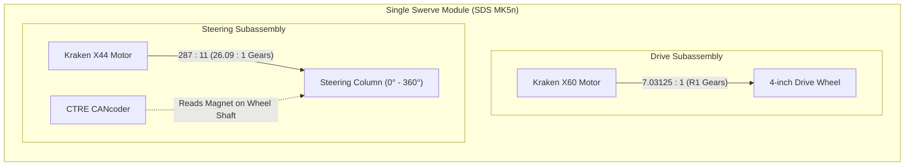
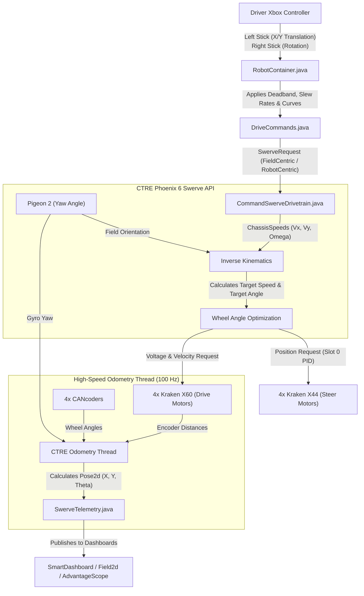

# Preseason Drive Chassis 2027 — Swerve Base

Welcome to the **Ironclad Owls (2027)** swerve drive codebase! This repository contains the complete foundation for driving an FRC robot using an inverted swerve drive chassis.

Whether you are a seasoned programmer or writing your first line of robot code, this guide will walk you through how swerve works, how this software is structured, and how data flows from a driver's thumbstick to the wheels on the carpet.

---

## 📑 Table of Contents
1. [Swerve Drive 101: The Basics](#-swerve-drive-101-the-basics)
2. [Hardware Overview](#-hardware-overview)
3. [Software Architecture & Data Flow](#-software-architecture--data-flow)
4. [File-by-File Code Walkthrough](#-file-by-file-code-walkthrough)
5. [The Coordinate System](#-the-coordinate-system)
6. [Central Configuration Guide (`SwerveConfig.java`)](#-central-configuration-guide-swerveconfigjava)
7. [Default CAN ID Map](#-default-can-id-map)
8. [Module Zeroing / Calibration Procedure](#-module-zeroing--calibration-procedure)
9. [RoboRIO 1 Considerations & Safeguards](#-roborio-1-considerations--safeguards)
10. [Driver Controls](#-driver-controls)
11. [Building, Testing & Deploying](#-building-testing--deploying)

---

## 🧠 Swerve Drive 101: The Basics

### What is Swerve Drive?
Unlike traditional **Tank (Differential) Drive**—where wheels can only spin forward or backward—a **Swerve Drive** (or holonomic drive) gives each of the 4 corner wheel modules **two independent degrees of freedom**:
1. **Drive Motor**: Controls how fast the wheel spins forward or reverse.
2. **Steer (Azimuth) Motor**: Rotates the wheel's steering column 360° to face any direction.

Because every module can point in any direction independently, the robot can **translate** (move forward, backward, or strafe sideways) while simultaneously **rotating** around its center.



### Field-Centric vs. Robot-Centric Driving
* **Robot-Centric**: Pushing the joystick forward drives in the direction the robot's front intake is pointing. If the robot spins 90° clockwise, "forward" on the stick now drives to your right.
* **Field-Centric (Standard)**: Pushing the joystick away from the driver station drives straight toward the opposite alliance wall—**regardless of which way the robot is facing or spinning**.
  - How it works: The robot uses a gyroscope (**CTRE Pigeon 2**) to measure its heading angle $\theta$, then rotates the driver's translation inputs by $-\theta$ before sending commands to the wheels.

---

## ⚙️ Hardware Overview

Our chassis is equipped with industry-leading FRC components:

| Component | Model | Role | Why We Use It |
| :--- | :--- | :--- | :--- |
| **Swerve Modules** | **SDS MK5n (R1)** | Mechanical assembly | Inverted-motor design with enclosed gears to keep out carpet fibers; compact 5"x7.5" footprint. |
| **Drive Motors** | **Kraken X60 (Talon FX)** | Wheel propulsion | High-power brushless motor (over 1.1 kW burst power) providing rapid acceleration and top speeds ~14.8 ft/s (4.5 m/s). |
| **Steer Motors** | **Kraken X44 (Talon FX)** | Wheel rotation | Compact, lightweight brushless motor with high torque for instant wheel angle alignment. |
| **Absolute Encoders**| **CTRE CANcoder** | Azimuth feedback | Absolute magnetic encoder on each module that remembers the wheel's true angle even after the robot is power-cycled. |
| **Gyro / IMU** | **CTRE Pigeon 2** | Heading orientation | 9-axis inertial measurement unit providing precise robot yaw for field-centric driving and odometry. |
| **RoboRIO** | **RoboRIO 1** | Main controller | Runs our compiled WPILib Java program and manages the CAN bus. |

---

## 🔄 Software Architecture & Data Flow

Here is how user input transforms into motor output every 20 milliseconds (50 times per second):



### What is Wheel Angle Optimization?
If a wheel is currently facing **0°** and the driver requests it to face **180°** at 2 m/s:
- Without optimization: The steer motor would have to rotate 180° before the wheel could drive.
- **With optimization**: The code instead keeps the wheel at **0°** and reverses the drive motor to **-2 m/s**. The wheel never needs to turn more than 90° in either direction!

---

## 📂 File-by-File Code Walkthrough

```
Preseason-Drive-Chassis-2027/
├── src/main/java/frc/robot/
│   ├── Main.java                        # 1. JVM entry point
│   ├── Robot.java                       # 2. WPILib TimedRobot life-cycle
│   ├── RobotContainer.java              # 3. Connects controllers, commands & subsystems
│   ├── Constants.java                   # 4. General team constants
│   ├── configs/
│   │   └── SwerveConfig.java            # ⭐ 5. THE CONTROL PANEL (Edit this!)
│   ├── generated/
│   │   └── TunerConstants.java          # 6. CTRE hardware factory builder
│   ├── subsystems/
│   │   ├── CommandSwerveDrivetrain.java # 7. The Drivetrain subsystem
│   │   └── SwerveTelemetry.java         # 8. Dashboard visualizer
│   └── commands/
│       └── DriveCommands.java           # 9. Driving command behaviors
```

### 1. `Main.java` & `Robot.java`
- **[`Main.java`](file:///Users/adonai/Developer/Ironclad/Preseason-Drive-Chassis-2027/src/main/java/frc/robot/Main.java)**: Standard Java `public static void main` entry point that starts the robot code.
- **[`Robot.java`](file:///Users/adonai/Developer/Ironclad/Preseason-Drive-Chassis-2027/src/main/java/frc/robot/Robot.java)**: Extends WPILib `TimedRobot`. In `robotPeriodic()`, it runs the `CommandScheduler`, which polls controller buttons and advances running commands.

### 2. `RobotContainer.java`
- **[`RobotContainer.java`](file:///Users/adonai/Developer/Ironclad/Preseason-Drive-Chassis-2027/src/main/java/frc/robot/RobotContainer.java)**: The central wiring hub.
  - Instantiates the drivetrain via `TunerConstants.createDrivetrain()`.
  - Sets the default command so the robot always drives when thumbsticks are moved.
  - Binds buttons (Zero Gyro on **Y**, X-Stance Brake on **X**, Heading Snapping on the **D-Pad**).
  - Configures the autonomous selector (`m_autoChooser`).

### 3. `configs/SwerveConfig.java` ⭐
- **[`SwerveConfig.java`](file:///Users/adonai/Developer/Ironclad/Preseason-Drive-Chassis-2027/src/main/java/frc/robot/configs/SwerveConfig.java)**: **The single most important file for tuning.** Contains every CAN ID, gear ratio, current limit, PID gain, and magnet offset.

### 4. `generated/TunerConstants.java`
- **[`TunerConstants.java`](file:///Users/adonai/Developer/Ironclad/Preseason-Drive-Chassis-2027/src/main/java/frc/robot/generated/TunerConstants.java)**: Translates the values in `SwerveConfig.java` into CTRE Phoenix 6 objects (`SwerveDrivetrainConstants`, `SwerveModuleConstants`, and `Slot0Configs`).

### 5. `subsystems/CommandSwerveDrivetrain.java`
- **[`CommandSwerveDrivetrain.java`](file:///Users/adonai/Developer/Ironclad/Preseason-Drive-Chassis-2027/src/main/java/frc/robot/subsystems/CommandSwerveDrivetrain.java)**: The WPILib `Subsystem` wrapping CTRE's base swerve drivetrain.
  - Runs high-frequency odometry in a background thread.
  - Contains hooks for **PathPlanner 2025** autonomous routines (`AutoBuilder.configure`).
  - Supports desktop simulation physics via WPILib Notifiers.

### 6. `commands/DriveCommands.java`
- **[`DriveCommands.java`](file:///Users/adonai/Developer/Ironclad/Preseason-Drive-Chassis-2027/src/main/java/frc/robot/commands/DriveCommands.java)**: Contains helper factories for all driving modes:
  - `fieldCentricDrive()`: Normal driving with deadband and rate limiting.
  - `robotCentricDrive()`: Robot-oriented driving for intaking or alignment.
  - `faceAngleDrive()`: Locks heading to a fixed angle while allowing full translation.
  - `xBrake()`: Locks wheels into an 'X' shape.

### 7. `subsystems/SwerveTelemetry.java`
- **[`SwerveTelemetry.java`](file:///Users/adonai/Developer/Ironclad/Preseason-Drive-Chassis-2027/src/main/java/frc/robot/subsystems/SwerveTelemetry.java)**: Sends robot position $(X, Y, \theta)$, chassis velocity, and module states to `Field2d`, SmartDashboard, and AdvantageScope.

---

## 📐 The Coordinate System

WPILib and CTRE use standard robotics coordinates (NWU: North-West-Up):
- **+X**: Forward (toward red/blue opposing end)
- **+Y**: Left
- **+Rotation ($\theta$)**: Counter-Clockwise (CCW) is positive

```
            +X (Forward)
                 ^
                 |
   [FL Module]   |   [FR Module]
       (+X, +Y)  |       (+X, -Y)
                 |
+Y (Left) <------+------> -Y (Right)
                 |
   [BL Module]   |   [BR Module]
       (-X, +Y)  |       (-X, -Y)
                 |
                 v
            -X (Backward)
```

---

## ⚡ Central Configuration Guide (`SwerveConfig.java`)

All configurations live in **[`src/main/java/frc/robot/configs/SwerveConfig.java`](file:///Users/adonai/Developer/Ironclad/Preseason-Drive-Chassis-2027/src/main/java/frc/robot/configs/SwerveConfig.java)**. Here are the key sections:

### 1. SDS MK5n R1 Gearing Specs
```java
// SDS MK5n R1 Drive ratio: (54/12) * (25/32) * (30/15) = 7.03125 : 1
public static final double DRIVE_GEAR_RATIO = 7.03125;

// SDS MK5n Azimuth gear train ratio: 287 / 11 ≈ 26.0909 : 1
public static final double STEER_GEAR_RATIO = 287.0 / 11.0;

// Nominal wheel radius (4-inch diameter wheel = 2-inch radius)
public static final double WHEEL_RADIUS_METERS = Units.inchesToMeters(2.0);
```

### 2. Physical Dimensions
```java
public static final double TRACK_WIDTH_X_METERS = Units.inchesToMeters(22.75); // Wheelbase
public static final double TRACK_WIDTH_Y_METERS = Units.inchesToMeters(22.75); // Track width
```

### 3. Motor PID Gains
```java
// Steer Motor (Slot 0 Position Closed Loop)
public static final double STEER_KP = 100.0;
public static final double STEER_KD = 0.5;

// Drive Motor (Slot 0 Velocity Closed Loop)
public static final double DRIVE_KP = 0.12;
public static final double DRIVE_KS = 0.20; // Static friction voltage
public static final double DRIVE_KV = 0.12; // Velocity feedforward (Volts / RPS)
```

---

## 🔌 Default CAN ID Map

Every CTRE device on the CAN bus must have a unique CAN ID:

```
[RoboRIO 1] ====== CAN BUS ("rio") ======+
                                         |--- Pigeon 2 (ID 13)
                                         |
                                         |--- Front Left:  Drive (ID 1),  Steer (ID 2),  CANcoder (ID 3)
                                         |--- Front Right: Drive (ID 4),  Steer (ID 5),  CANcoder (ID 6)
                                         |--- Back Left:   Drive (ID 7),  Steer (ID 8),  CANcoder (ID 9)
                                         +--- Back Right:  Drive (ID 10), Steer (ID 11), CANcoder (ID 12)
```

| Module Location | Drive Motor (Kraken X60) | Steer Motor (Kraken X44) | Absolute Encoder (CANcoder) |
| :--- | :---: | :---: | :---: |
| **Front Left (FL)** | `1` | `2` | `3` |
| **Front Right (FR)** | `4` | `5` | `6` |
| **Back Left (BL)** | `7` | `8` | `9` |
| **Back Right (BR)** | `10` | `11` | `12` |
| **IMU / Gyro** | — | — | **Pigeon 2**: `13` |

---

## 🛠️ Module Zeroing / Calibration Procedure

```mermaid
sequenceDiagram
    autonumber
    actor Tech as Programmer/Tech
    participant Robot as Physical Robot (On Cart)
    participant Tuner as CTRE Phoenix Tuner X
    participant Config as SwerveConfig.java

    Tech->>Robot: Align all 4 wheels straight with straightedge (bevels facing left)
    Tech->>Tuner: Connect to RoboRIO ("rio" CAN bus)
    Tuner->>Robot: Read Absolute Position of CANcoders (IDs 3, 6, 9, 12)
    Tech->>Config: Copy negated readings into FL/FR/BL/BR_CANCODER_OFFSET
    Tech->>Robot: Build & Deploy code
    Tech->>Robot: Enable Teleop; push stick forward -> wheels drive straight!
```

1. **Place the robot on a cart** so the wheels can spin freely.
2. **Mechanically align all 4 wheels** straight forward using a flat 1x1 aluminum extrusion pressed against the wheels. Ensure all bevel gears face the **LEFT** side of the chassis (or your team standard).
3. **Open CTRE Phoenix Tuner X** on your laptop and connect to the robot via USB or radio.
4. Go to **Devices** on the `rio` CAN bus and locate each CANcoder:
   - Front Left: CANcoder `3`
   - Front Right: CANcoder `6`
   - Back Left: CANcoder `9`
   - Back Right: CANcoder `12`
5. Note down the **Absolute Position** value (in rotations, ranging between `-0.5` and `+0.5`).
6. Open **[`SwerveConfig.java`](file:///Users/adonai/Developer/Ironclad/Preseason-Drive-Chassis-2027/src/main/java/frc/robot/configs/SwerveConfig.java)** and enter the **negative** of each measured angle:
   ```java
   public static final double FL_CANCODER_OFFSET = -0.1234;
   public static final double FR_CANCODER_OFFSET =  0.4567;
   public static final double BL_CANCODER_OFFSET = -0.0891;
   public static final double BR_CANCODER_OFFSET =  0.2345;
   ```
7. Deploy code to the robot and verify that wheels stay straight when teleop is enabled.

---

## 🛡️ RoboRIO 1 Considerations & Safeguards

The **RoboRIO 1** has two hardware constraints that are accounted for in this codebase:

### 1. CAN Bus Utilization (1 Mbps Bandwidth)
With **13 CTRE devices** (8 Talon FXs + 4 CANcoders + 1 Pigeon 2), running Phoenix 6 default CANivore status signals (250 Hz) on a RoboRIO 1 will saturate the bus and cause frame drops.
- **Our Solution**: In [`SwerveConfig.java`](file:///Users/adonai/Developer/Ironclad/Preseason-Drive-Chassis-2027/src/main/java/frc/robot/configs/SwerveConfig.java#L226-L233), `ODOMETRY_UPDATE_FREQUENCY_HZ` is set to **`100.0 Hz`**. This delivers ultra-responsive odometry without overloading the RIO's CAN bus.
- *If your team adds a CTRE CANivore later*, simply set `CAN_BUS_NAME = "canivore"` and increase frequency to `250.0`.

### 2. Battery Brownout Prevention (6.8V Protection)
Kraken X60 motors can pull over 300A stall current each. If all 4 drive motors rapidly reverse direction simultaneously, the battery voltage will dip below 6.8V, causing the RoboRIO to **brown out and reboot**.
- **Our Solution**:
  - Drive Stator Limit: **80A** (Limits max motor torque).
  - Drive Supply Limit: **50A continuous / 65A burst** (Protects the 12V battery line).
  - Input Slew Rate Limiters: Acceleration limits prevent instant current spikes on stick movements.

---

## 🎮 Driver Controls (Xbox Controller)

```
        [Left Bumper]                       [Right Bumper]
       (Hold: Slow Mode)                 (Hold: Robot-Centric)
               |                                   |
         [Left Stick]                         [Right Stick]
       (Translation X/Y)                      (Rotation Yaw)
               |                                   |
            ( D-PAD )                         ( Y / X Buttons )
      Up:    Snap to 0°                     Y: Zero Gyro Heading
      Right: Snap to -90°                   X: Defense X-Brake
      Down:  Snap to 180°
      Left:  Snap to +90°
```

| Control | Action | Function |
| :--- | :--- | :--- |
| **Left Stick Y** | Translation X | Forward / Backward (+ forward) |
| **Left Stick X** | Translation Y | Strafe Left / Right (+ left) |
| **Right Stick X** | Rotation | Rotate CCW / CW |
| **Left Bumper (Hold)** | Slow / Precision Mode | Scales speed down to 35% for delicate scoring alignment |
| **Right Bumper (Hold)** | Robot-Centric Mode | Temporarily switches to robot-oriented driving |
| **Y Button (Press)** | Zero Gyro | Re-calibrates current heading as field forward (0°) |
| **X Button (Hold)** | Defense "X-Stance" Brake | Angles wheels into an 'X' shape to resist being pushed |
| **D-Pad Up / Right / Down / Left** | Angle Snapping | Automatically locks and drives facing 0°, -90°, 180°, or +90° |

---

## 🚀 Building, Testing & Deploying

### Build the Code
To check for compilation errors:
```bash
./gradlew build
```

### Run Unit Tests
To run automated tests that verify geometry, CAN ranges, and current limits:
```bash
./gradlew test
```

### Deploy to RoboRIO
Connect to the robot via USB-B cable, Ethernet, or robot Wi-Fi, then run:
```bash
./gradlew deploy
```
*(Or in VS Code: press `Shift + F5` or select **WPILib: Deploy Robot Code** from the Command Palette)*.
